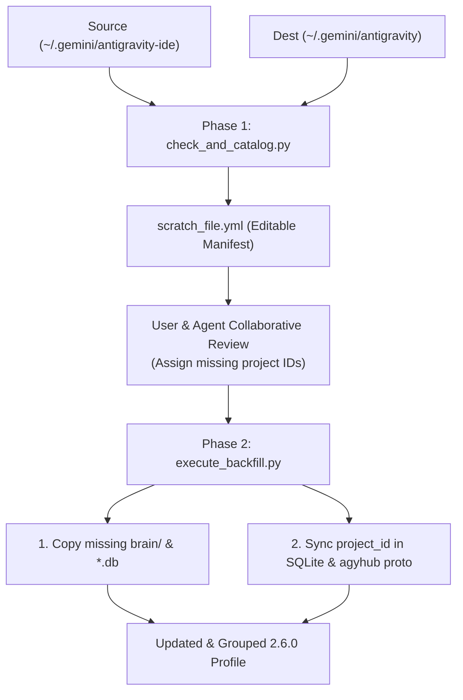

# Antigravity 2.5.x to 2.6.0 Migration & Backfill Guide

This guide details the technical background, failure modes, and operational workflow for migrating historical conversation data from **Antigravity IDE 2.5.x** (`~/.gemini/antigravity-ide/`) into a unified **Antigravity 2.6.0+** profile (`~/.gemini/antigravity/`).

---

## ⚠️ Critical Prerequisite for AI Agents: Execution Surface & Safe Handoff

Before taking action, determine your current execution environment:

> [!IMPORTANT]
> **ARE YOU RUNNING INSIDE ANTIGRAVITY DESKTOP OR ANTIGRAVITY IDE?**
>
> - **If YES (Running inside Antigravity Desktop/IDE/VS Code)**:
>   - ✅ **You CAN run Phase 1 (`check_and_catalog.py`)**: You can audit the directories, inspect historical conversation health, and collaboratively review/edit `scratch_file.yml` with the user to map project IDs.
>   - 🛑 **DO NOT run Phase 2 (`execute_backfill.py`) from this session**: Phase 2 requires Antigravity Desktop and its language server hub to be **completely closed** so in-memory protobuf buffers don't overwrite the migration. If you attempt to terminate Desktop or run Phase 2 from within Desktop, you risk killing your host process or having Desktop overwrite the backfilled state upon closing.
>   - **What to do**: Complete Phase 1 and the review in `scratch_file.yml`. Then instruct the user:
>     > *"Phase 1 cataloging and project mapping are complete! Please completely close Antigravity Desktop now, open a separate terminal (or run an independent CLI daemon), and execute the Phase 2 command below to finish the backfill."*
>
> - **If NO (Running via Antigravity CLI daemon, OpenCode, Claude Code, Zed ACP, Codex, or external terminal)**:
>   - ✅ **PROCEED END-TO-END**: You can run both Phase 1 and Phase 2. Just ensure Antigravity Desktop is closed before running Phase 2.

---

## 🌐 Platform & Operating System Disclaimer

> [!NOTE]
> **Tested Platform**: This toolkit has been extensively verified on **Linux (systemd / Electron 2.x / Wayland & X11)**.
> Read (and if necessary) adapt the scripts to help the user to migrate their conversations. 
>
> **Adapting for macOS & Windows**:
> The underlying SQLite databases and protobuf wire formats (`agyhub_summaries_proto.pb`) should be identical across all operating systems. However, default paths will be different:
>
> | Platform | Default Source (`--old-ide-dir`) | Default Target (`--destination-dir`) | Default Desktop Config (`--config-dir`) |
> | :--- | :--- | :--- | :--- |
> | **Linux** | `~/.gemini/antigravity-ide` | `~/.gemini/antigravity` | `~/.config/Antigravity` |
> | **macOS** | `~/.gemini/antigravity-ide` | `~/.gemini/antigravity` | `~/Library/Application Support/Antigravity` |
> | **Windows** | `%USERPROFILE%\.gemini\antigravity-ide` | `%USERPROFILE%\.gemini\antigravity` | `%APPDATA%\Antigravity` |
>
> Always specify `--old-ide-dir`, `--destination-dir`, and `--config-dir` explicitly when running on non-Linux environments.

---

## 1. Background & Root Causes

When upgrading from Antigravity IDE 2.5.x to 2.6.0 (converging the VS Code IDE fork, the Desktop Electron application, and CLI daemons):

### Failure Mode A: Missing `brain/` Directories
- **What happened**: The internal migration loop in 2.6.0 migrated SQLite records and copied `conversations/*.db`, but **completely omitted copying `brain/<id>/` directories**.
- **Symptom**: Clicking any migrated conversation in the sidebar triggered the toast error:  
  `Conversation unavailable: The conversation could not be loaded because its data was not found`.
- **Fix**: Faithfully sync all `brain/<id>/` directories from source to destination.

### Failure Mode B: Missing Project Associations
- **What happened**: Antigravity IDE 2.5.x tracked workspaces by directory path (`workspace_uris`), but Antigravity 2.6.0 groups sidebar items using a cloud/hub UUID (`project_id`). The automatic migration left `project_id = ""` (empty string) for all historical sessions.
- **Symptom**: Migrated conversations were dumped into the flat "Conversations" list at the bottom of the sidebar instead of inside their respective project accordions under "Projects".
- **Fix**: Resolve workspace paths to active project UUIDs and write field `17.18` into `agyhub_summaries_proto.pb` and SQLite `conversation_summaries.db`.

### Failure Mode C: In-Memory Protobuf Cache Clobber
- **What happened**: Antigravity Desktop runs a background language server hub (`language_server --subclient_type hub`) that caches `agyhub_summaries_proto.pb` in RAM.
- **Symptom**: Any out-of-band edits to SQLite or `.pb` files made while Desktop is open are overwritten on disk when Desktop closes.
- **Fix**: Always ensure Antigravity Desktop is closed before running backfill scripts.

---

## 2. Two-Phase Tooling Architecture



---

## 3. Step-by-Step Operator / Agent Workflow

### Step 1: Run Pre-Flight Catalog
Run `check_and_catalog.py` to audit directory health and generate the editable manifest:

```bash
uv run --with pyyaml python3 check_and_catalog.py \
  --old-ide-dir ~/.gemini/antigravity-ide \
  --destination-dir ~/.gemini/antigravity \
  --output scratch_file.yml
```

### Step 2: Collaborative Review (`scratch_file.yml`)
Open `scratch_file.yml` and review the `backfills` list:

1. **Check `conversationsCount`**:
   - `total`: Total conversations discovered for this workspace path.
   - `fullyMigrated`: Sessions that already have `.db`, `brain/`, and a `project_id`.
   - `migratable`: Sessions ready to be linked.
2. **Assign Project UUIDs**:
   - Locate any workspace where `projectAssigned: false` and `projectIdToAssign: ""`.
   - Match it against the `projects` section at the top of the YAML file.
   - Set `projectIdToAssign: "<project-uuid>"`.
   - *(Tip: If a strategic project is not yet in the `projects` list, open it once in Antigravity Desktop so Desktop assigns it a native project UUID, close Desktop, and re-run Step 1).*

### Step 3: Execute the Backfill
Ensure Antigravity Desktop is closed, then run:

```bash
uv run --with pyyaml --with blackboxprotobuf python3 execute_backfill.py \
  --manifest scratch_file.yml \
  --old-ide-dir ~/.gemini/antigravity-ide \
  --destination-dir ~/.gemini/antigravity
```

#### Optional Flags:
- `--migrate-unmarked`: *(Experimental)* Scans for conversations lacking a `.<id>.done` sentinel file in the source folder, registers them into SQLite, and touches `.<id>.done`.
- `--run-even-antigravity-active`: Bypasses the process check ensuring Antigravity Desktop is closed.
- `--skip-backup`: Skips creating safety copies of SQLite and `.pb` files before execution.

### Step 4: Verification
1. Launch Antigravity Desktop.
2. Verify that historical conversations appear nested inside their respective **"Projects"** accordions.
3. Click a migrated conversation to confirm it loads immediately without toast errors.
4. Verify artifacts and scratch files display cleanly.
