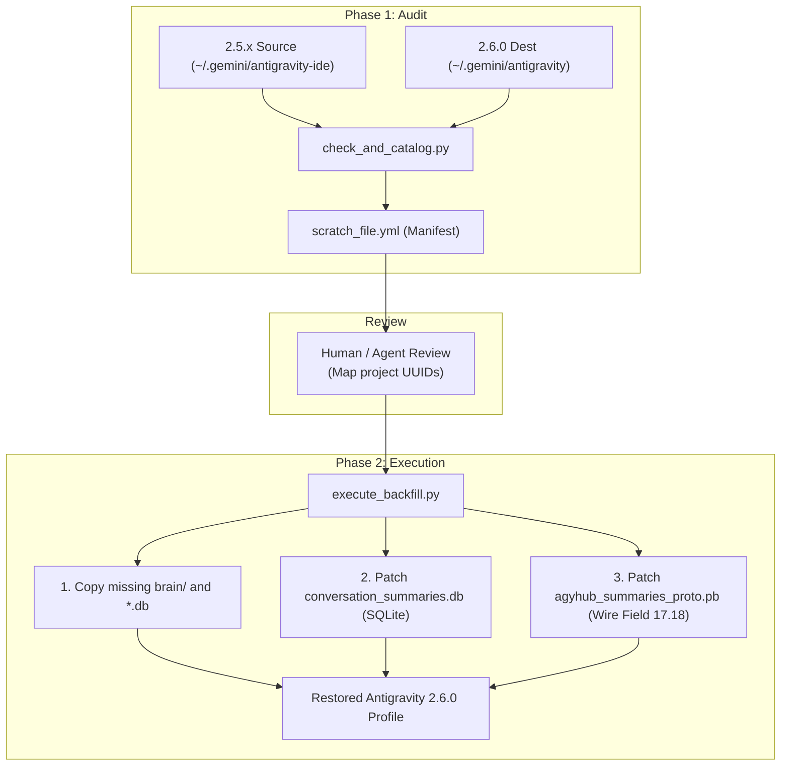

# Antigravity 2.5.x → 2.6.0 Migration & Repair Toolkit (`agy-restore`)

> **Safely restore missing `brain/` artifacts, fix broken conversation toast errors, and re-link historical sessions to their project accordions in Antigravity 2.6.0+.**

[-blue.svg)](#-platform--operating-system-notes)
[](LICENSE)
[](#)

---

## 💥 The Problem: What Broke in 2.6.0?

With the release of **Antigravity 2.6.0**, the architecture unified the standalone VS Code IDE fork, the Desktop Electron application, and the CLI daemons (`agy`). 

However, users upgrading from **Antigravity IDE 2.5.x** frequently hit two major bugs:

### 1. The Missing `brain/` Directories
When clicking past conversations in the sidebar, Antigravity throws a toast error:
> ❌ **`Conversation unavailable: The conversation could not be loaded because its data was not found`**

**Root Cause**: The official 2.6.0 internal migration copied the SQLite files (`conversations/*.db`), but **completely omitted copying the `brain/<id>/` directories** containing artifacts, transcripts, scratchpads, and execution logs.

### 2. Missing Project Associations (The "Flat Sidebar" Mess)
All migrated historical conversations are dumped into a flat, unorganized list at the bottom of the sidebar under **"Conversations"**, rather than nested inside their respective **"Projects"** accordions.

**Root Cause**: Antigravity IDE 2.5.x tracked workspaces by directory path (`workspace_uris`), but 2.6.0 groups items using a native project UUID (`project_id`). The automatic migrator left `project_id = ""` (empty string) for historical sessions.

### ⚠️ Why Naive Workarounds Make Things Worse
If you tried fixing this manually, you might have hit these traps:
- **Symlinking folders**: Symlinking `conversations/` or `brain/` between profiles causes toast crashes when sidebar protobuf caches (`agyhub_summaries_proto.pb`) don't match the target SQLite database.
- **Sharing profiles between Desktop and CLI**: Running `agy remote-control serve` on the same profile as Antigravity Desktop triggers an **8-second WebChannel disconnect storm** (`[[2, ["close"]]]`) because both clients fight over the same `installation_uuid`.
- **Editing files while Desktop is open**: Antigravity Desktop runs a background language server hub (`language_server --subclient_type hub`) that caches sidebar protobuf data in RAM. Any manual edits to `.pb` or SQLite files while Desktop is running will be **silently overwritten on disk when Desktop closes**.

---

## ✨ What This Toolkit Does

This toolkit provides a safe, 2-phase migration pipeline:

1. 🔍 **Audit & Catalog (`check_and_catalog.py`)**:
   - Inspects your 2.5.x (`~/.gemini/antigravity-ide`) and 2.6.0 (`~/.gemini/antigravity`) profiles.
   - Detects missing `.db` files and missing `brain/` directories.
   - Matches active Desktop projects against historical workspace paths.
   - Outputs a human- and agent-editable manifest (`scratch_file.yml`).
2. ✍️ **Collaborative Review**:
   - Review or adjust project mappings in `scratch_file.yml` (manually or with your favorite coding agent).
3. 🚀 **Execute Backfill (`execute_backfill.py`)**:
   - Creates automatic `.bak` backups before modifying anything.
   - Faithfully copies missing `brain/<id>/` folders and `.db` files.
   - Backfills `project_id` in both SQLite (`conversation_summaries.db`) and raw protobuf (`agyhub_summaries_proto.pb`).
   - Supports experimental recovery of conversations lacking `.done` sentinel markers (`--migrate-unmarked`).

---

## ⚠️ Critical Rule: Safe Execution Surfaces

> [!IMPORTANT]
> **Can an AI coding agent help with this?**  
> **YES!** But follow this execution boundary:
>
> - **Inside Antigravity Desktop / IDE / VS Code**:  
>   The agent **CAN** run Phase 1 (`check_and_catalog.py`), inspect directory health, and help you map project IDs in `scratch_file.yml`.  
>   🛑 **However, the agent MUST NOT run Phase 2 (`execute_backfill.py`) from inside Desktop.** Desktop must be completely closed so its background language server doesn't overwrite the migration.
> - **External Terminal / CLI Agent**:  
>   If running from a standalone terminal, an independent Antigravity CLI daemon (`agy remote-control serve` with a dedicated profile), **Claude Code**, **OpenCode**, or **Zed ACP**, you can run both phases end-to-end. Just verify Antigravity Desktop is closed before executing Phase 2.

See [AgentGuideline.md](AgentGuideline.md) for full agent prompts and guidelines.

---

## 🌐 Platform & Operating System Notes

- **Linux (systemd / Electron 2.x / Wayland & X11)**: Extensively tested and verified. Default paths work out of the box.
- **macOS & Windows**: The underlying SQLite schemas and protobuf wire formats are cross-platform identical. However, default paths differ:

| Platform | Old 2.5.x IDE Dir (`--old-ide-dir`) | 2.6.0 Target Dir (`--destination-dir`) | Desktop Config (`--config-dir`) |
| :--- | :--- | :--- | :--- |
| **Linux** | `~/.gemini/antigravity-ide` | `~/.gemini/antigravity` | `~/.config/Antigravity` |
| **macOS** | `~/.gemini/antigravity-ide` | `~/.gemini/antigravity` | `~/Library/Application Support/Antigravity` |
| **Windows** | `%USERPROFILE%\.gemini\antigravity-ide` | `%USERPROFILE%\.gemini\antigravity` | `%APPDATA%\Antigravity` |

> [!TIP]
> If you are on macOS or Windows, have your AI agent verify your local paths and pass them via the CLI flags!

---

## 🚀 Quickstart Guide

### Prerequisites
- Python 3.10+
- [`uv`](https://docs.astral.sh/uv/) (recommended for zero-install dependencies), or standard `python3` with `pyyaml` and `blackboxprotobuf`.

```bash
# Clone the repository
git clone git@github.com:benedictjohannes/agy-restore-2.5.x-2.6.0.git
cd agy-restore-2.5.x-2.6.0
```

---

### Step 1: Run Pre-Flight Catalog (Phase 1)

Run `check_and_catalog.py` to audit directory health and generate the migration manifest:

```bash
uv run --with pyyaml python3 check_and_catalog.py \
  --old-ide-dir ~/.gemini/antigravity-ide \
  --destination-dir ~/.gemini/antigravity \
  --output scratch_file.yml
```

*(If not using `uv`: `pip install pyyaml` then run `python3 check_and_catalog.py`)*

---

### Step 2: Review `scratch_file.yml`

Open `scratch_file.yml` in your editor. You will see:
- `projects`: Active projects detected in Antigravity Desktop with their UUIDs.
- `backfills`: Discovered workspaces and conversation counts.

Look for entries where `projectAssigned: false` and `projectIdToAssign: ""`:

```yaml
- workspace: /home/benedict/www/ossRepos/myProject
  projectAssigned: false
  projectIdToAssign: ""  # <-- Paste the matching project UUID here
  conversationsCount:
    total: 8
    fullyMigrated: 0
    migratable: 8
```

> **Pro-Tip**: If a project isn't listed in `projects` yet, open that folder once in Antigravity Desktop so Desktop registers a native project UUID for it, close Desktop, and re-run Step 1.

---

### Step 3: Execute the Backfill (Phase 2)

1. **Quit Antigravity Desktop completely**:
   ```bash
   pkill -f Antigravity || killall Antigravity
   ```
2. **Run the backfill execution script**:
   ```bash
   uv run --with pyyaml --with blackboxprotobuf python3 execute_backfill.py \
     --manifest scratch_file.yml \
     --old-ide-dir ~/.gemini/antigravity-ide \
     --destination-dir ~/.gemini/antigravity
   ```

#### Helpful Flags:
- `--migrate-unmarked`: *(Experimental)* Also scans for sessions lacking the internal `.<id>.done` sentinel file in 2.5.x, registers them into SQLite, and touches the marker.
- `--skip-backup`: Disables creating `.bak` copies before execution (not recommended).

---

### Step 4: Verification

1. Launch **Antigravity Desktop**.
2. Expand your project accordions under **"Projects"** in the sidebar. Your historical conversations should now appear neatly organized under their respective projects.
3. Click any migrated conversation: it should open immediately with full transcripts, artifacts, and scratchpads without toast errors.

---

## 🛠️ Architecture & Deep Dive

For the curious and fellow toolbuilders, here is what is happening under the hood:



### The Protobuf Sidebar Index (`agyhub_summaries_proto.pb`)
Antigravity Desktop 2.6.0 indexes conversation metadata and project groupings in a binary protobuf file (`agyhub_summaries_proto.pb`). Within each conversation record:
- Field `1`: Conversation UUID
- Field `6`: Title / Summary
- Field `17.18`: Project UUID association

When `project_id` is empty, Desktop cannot associate the conversation with any project accordion. `execute_backfill.py` uses `blackboxprotobuf` to decode the wire format, inject field `17.18`, and re-encode the binary stream without requiring private `.proto` schemas.

### Rollback
If you ever need to revert the changes:
`execute_backfill.py` creates timestamped backups of modified files:
- `~/.gemini/antigravity/conversation_summaries.db.bak`
- `~/.gemini/antigravity/agyhub_summaries_proto.pb.bak`

Simply copy the `.bak` files back over the originals while Desktop is closed.

---

## 🤝 Contributing & Community

Built after extensive reverse-engineering of Antigravity's multi-client architecture and storage schemas. 

- Questions or feedback? Join the discussion on [r/google_antigravity](https://reddit.com/r/google_antigravity).
- Found an edge case on macOS or Windows? Pull requests and issue reports are very welcome!

---

## 📜 License

[MIT](LICENSE) © Benedict Johannes
