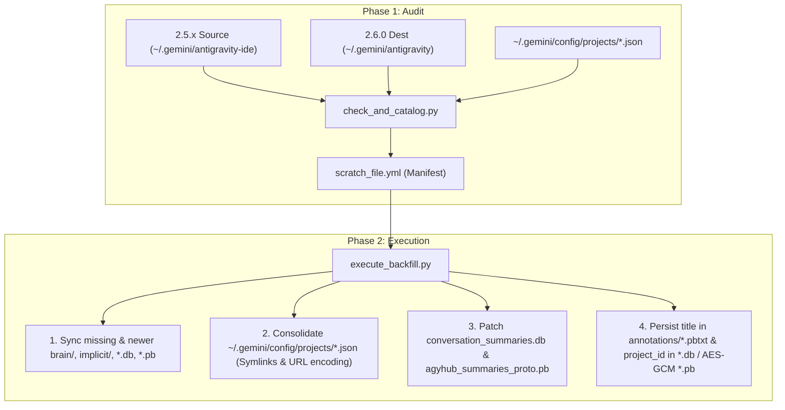

# Antigravity 2.5.x to 2.6.0 Migration & Repair Toolkit (`agy-restore`)

> **Restore missing and stale `brain/` artifacts, fix broken conversation toast errors, recover 2.6.0 titles, and permanently re-link historical sessions to their project accordions in Antigravity 2.6.0+.**

[-blue.svg)](#-platform--operating-system-notes)
[](LICENSE)
[](#)

---

## Fork Origin & Modifications

This repository ([`wh-sugiharto/agy-restore-2.5.x-2.6.0`](https://github.com/wh-sugiharto/agy-restore-2.5.x-2.6.0)) is a fork of [`benedictjohannes/agy-restore-2.5.x-2.6.0`](https://github.com/benedictjohannes/agy-restore-2.5.x-2.6.0) by Benedict Johannes.

While testing and deploying the migration toolkit on a long-running macOS research environment (spanning early Antigravity builds from January 2026 through Antigravity IDE 2.5.5 and Antigravity 2.6.0, with workspaces stored across local folders, symlinks, iCloud Drive, and Google Drive), we uncovered several additional data-loss mechanisms and schema shifts in Antigravity 2.6.0.

### Summary of Modifications in This Fork

1. **Three-Phase Directory Cycle Synchronization (`.antigravity` to `.antigravity-ide` back to `.antigravity`)**
   - Early Antigravity releases stored data in `~/.gemini/antigravity` (using `.pb` conversation files). Version 2.5.x migrated to `~/.gemini/antigravity-ide` while leaving the old `~/.gemini/antigravity` folder frozen on disk. Version 2.6.0 then switched back to `~/.gemini/antigravity`.
   - Because both the official 2.6.0 migrator and the upstream script only copied files that did not yet exist in the destination directory, any long-running conversation started before the 2.5.x transition and continued during 2.5.x remained stuck at its months-old snapshot in `~/.gemini/antigravity`.
   - This fork compares file sizes, modification timestamps, and `transcript.jsonl` freshness across both directories. It overwrites stale `.pb` and `.db` trajectory files with their newer 2.5.x versions and incrementally syncs all missing or newer files inside existing `brain/<uuid>/` and `implicit/` directories.

2. **Permanent Persistence in `annotations/*.pbtxt` and Encrypted `conversations/*.pb` / `*.db`**
   - Upstream only patched `conversation_summaries.db` and `agyhub_summaries_proto.pb`. However, whenever a user clicks a conversation in Antigravity 2.6.0, the `agy --hub` daemon reads `~/.gemini/antigravity/annotations/<cid>.pbtxt` (for the conversation title and view timestamp) and `~/.gemini/antigravity/conversations/<cid>.db` (`trajectory_metadata_blob` field `18`) or AES-GCM encrypted `conversations/<cid>.pb` (top-level protobuf field `7.18` `project_id`). If those underlying files lack the title or project UUID, `agy --hub` immediately overwrites `conversation_summaries.db` and wipes the restored metadata.
   - This fork injects `title:"..."` directly into `annotations/<cid>.pbtxt` and patches `project_id` into both SQLite `conversations/<cid>.db` (`trajectory_metadata_blob`) and AES-GCM 256-bit encrypted `conversations/<cid>.pb` files so that clicking a conversation never resets its title or project association.

3. **2.6.0 Title Backfill (Field `2.15.1`), `task.md` Title Recovery, and `last_modified_time` (Field `2.3`)**
   - Antigravity 2.5.x stored conversation summaries in `preview` (protobuf field `2.6`), whereas 2.6.0 displays `title` (SQLite column `title` and protobuf wire field `2.15.1`). This fork populates empty 2.6.0 titles from `preview`.
   - When both `title` and `preview` are empty in SQLite, this fork falls back to extracting the primary `# Task` heading from `brain/<cid>/task.md`.
   - Updates `last_modified_time` in SQLite and protobuf timestamp field `2.3` (`seconds` and `nanos`) using the actual modification time of the newer source trajectory files so restored conversations sort accurately by recency.

4. **Symlink Resolution & URL-Encoding Project Consolidation (`~/.gemini/config/projects/*.json`)**
   - Discovers native 2.6.0 project definitions directly from `~/.gemini/config/projects/*.json` in addition to `app_storage.json` and SQLite, while filtering out sentinel IDs (`outside-of-project`, `default-cli-project`).
   - Resolves symlinks via `os.path.realpath()` and normalizes URL-encoded workspace URIs (`%20` vs space, `%40` vs `@`).
   - Automatically merges duplicate project configurations (`<Project>` and `<Project> 2`) created when a workspace was opened via both a symlink and its real path, registering all URI variants inside the canonical project's `projectResources.resources` list and removing duplicate JSON configs.

5. **Heterogeneous Protobuf Wire Schema Handling (`blackboxprotobuf` `alt_typedefs`)**
   - Fixes a `KeyError: '2'` crash in `execute_backfill.py` caused when `blackboxprotobuf` encounters a record whose binary summary field resembles a nested message and splits repeated items in `agyhub_summaries_proto.pb` across `'2'` and `'2-1'` (`alt_typedefs`). Field definitions (`17.18`, `15.1`, `3`) are now registered across all typedef variants and resolved dynamically per item.

6. **Legacy `.pb` Conversation Support**
   - Audits and restores both `.db` and legacy `.pb` conversation files in `conversations/` (upstream only checked `.db`, which misclassified `.pb` conversations as unmigratable).

7. **macOS Compatibility & Orphaned Daemon Cleanup**
   - Adds macOS default configuration paths (`~/Library/Application Support/Antigravity IDE` and `Antigravity`).
   - Uses strict UUID pattern matching when scanning `brain/` to ignore macOS `.DS_Store` files and `tempmediaStorage` folders.
   - Improves process detection on macOS and Linux: ignores orphaned `chrome_crashpad_handler` processes and automatically terminates (`SIGTERM`) lingering background `agy --hub` daemons when the main Electron GUI window is already closed.

8. **WAL-Safe SQLite Backups & `--copy-files-only` Mode**
   - Uses `sqlite3.Connection.backup()` instead of raw file copying so backups of `conversation_summaries.db` include any uncommitted `-wal` journal frames.
   - Adds `--copy-files-only` to safely copy and sync missing or newer `brain/`, `implicit/`, and conversation files even while Antigravity is open.

---

## The Problem: What Broke in 2.6.0?

With the release of **Antigravity 2.6.0**, the architecture unified the standalone VS Code IDE fork, the Desktop Electron application, and the CLI daemons (`agy --hub`).

However, users upgrading from **Antigravity IDE 2.5.x** frequently hit three major issues:

### 1. Missing or Stale `brain/` Directories and `.pb` Trajectories
When clicking past conversations in the sidebar, Antigravity throws a toast error:
> **`Conversation unavailable: The conversation could not be loaded because its data was not found`**

Or, for conversations originally started before the 2.5.x transition and continued through 2.5.x, opening the conversation loads a stale snapshot from months ago.

**Root Cause**:
- The official 2.6.0 internal migration copied `.db` files in `conversations/`, but omitted copying the `brain/<id>/` directories containing artifacts, transcripts, scratchpads, and execution logs.
- Because 2.6.0 switched its data directory back from `~/.gemini/antigravity-ide` to `~/.gemini/antigravity` (which was previously used in early builds before 2.5.x), any `.pb` conversation file or `brain/<id>/` directory that already existed in `~/.gemini/antigravity` from months ago was skipped during migration instead of being updated with the newer 2.5.x files.

### 2. Missing Project Associations, Symlink Splits, and Empty 2.6.0 Titles
Migrated historical conversations are either dumped into an unorganized list, appear untitled, or fail to appear when a project is opened via a symlink.

**Root Cause**:
- Antigravity IDE 2.5.x tracked workspaces by directory path (`workspace_uris`), whereas 2.6.0 groups items using a native project UUID (`project_id`). The automatic migrator left `project_id = ""` for many historical sessions, or split the same folder into duplicate projects (`<Project>` and `<Project> 2`) when opened via a symlink versus its real path (such as iCloud Drive or Google Drive folders) or with different URL encodings (`%20` vs space, `%40` vs `@`).
- Antigravity 2.5.x stored conversation summaries in `preview` (protobuf field `2.6`), leaving the new 2.6.0 `title` column and protobuf field `2.15.1` empty.
- In 2.6.0, `"antigravity.defaultGroupByNone"` defaults to `true`, hiding project grouping unless disabled in `settings.json`.

### 3. Metadata Wiped Again When Clicking a Conversation
Even after patching `conversation_summaries.db` and `agyhub_summaries_proto.pb`, clicking a migrated conversation in the 2.6.0 UI can cause its title and project association to disappear again.

**Root Cause**:
- When a conversation is opened, `agy --hub` reloads `~/.gemini/antigravity/annotations/<cid>.pbtxt` and the underlying trajectory file (`conversations/<cid>.db` or encrypted `conversations/<cid>.pb`) and rewrites the summary row in `conversation_summaries.db`. Unless `annotations/<cid>.pbtxt` and the trajectory metadata blob are also patched, `agy --hub` overwrites the backfilled summary row with empty values.

---

## What This Toolkit Does

This toolkit provides a 2-phase migration and repair pipeline:

1. **Audit & Catalog (`check_and_catalog.py`)**:
   - Inspects your 2.5.x (`~/.gemini/antigravity-ide`) and 2.6.0 (`~/.gemini/antigravity`) profiles.
   - Detects missing `.db` and legacy `.pb` conversation files alongside missing `brain/<uuid>/` directories.
   - Discovers active projects from `~/.gemini/config/projects/*.json`, `app_storage.json`, and SQLite, normalizing URL-encoded paths (`%20`, `%40`), resolving symlinks (`os.path.realpath`) to merge duplicate projects, and excluding sentinel IDs (`default-cli-project`, `outside-of-project`).
   - Outputs a human- and agent-editable manifest (`scratch_file.yml`).
2. **Collaborative Review**:
   - Review or adjust project mappings in `scratch_file.yml`.
3. **Execute Backfill (`execute_backfill.py`)**:
   - Creates automatic WAL-safe `.bak` backups before modifying SQLite, protobuf, or `~/.gemini/config/projects` files.
   - Copies missing `brain/<id>/` folders and `.db` / `.pb` files, and overwrites stale destination files when `~/.gemini/antigravity-ide` holds a newer or larger version from the 2.5.x period.
   - Syncs missing or newer files inside `implicit/`.
   - Consolidates `~/.gemini/config/projects/*.json` so each canonical project registers both its symlink and resolved realpath URIs, removing duplicate project configs.
   - Backfills `project_id` (wire field `2.17.18`), 2.6.0 `title` from `preview` or `brain/<cid>/task.md` (wire field `2.15.1`), and `last_modified_time` (wire field `2.3`) in `conversation_summaries.db` and `agyhub_summaries_proto.pb`.
   - Permanently injects `title` into `annotations/<cid>.pbtxt` and `project_id` into `conversations/<cid>.db` (`trajectory_metadata_blob`) and AES-GCM encrypted `conversations/<cid>.pb` (field `7.18`).

---

## Safe Execution Boundaries

> [!IMPORTANT]
> **Can an AI coding agent help with this?**  
> **Yes**, provided you follow this boundary:
>
> - **Inside Antigravity Desktop / IDE / VS Code**:  
>   The agent can run Phase 1 (`check_and_catalog.py`), run `execute_backfill.py --copy-files-only`, inspect directory health, and map project IDs in `scratch_file.yml`.  
>   **However, do not run full Phase 2 (`execute_backfill.py` without `--copy-files-only`) from inside the Antigravity GUI.** Close the Antigravity GUI first and run Phase 2 from an external terminal (such as macOS Terminal or iTerm2) so the active hub daemon does not overwrite the index files on exit.

---

## Platform & Operating System Notes

| Platform | Old 2.5.x IDE Dir (`--old-ide-dir`) | 2.6.0 Target Dir (`--destination-dir`) | Desktop Config (`--config-dir`) |
| :--- | :--- | :--- | :--- |
| **Linux** | `~/.gemini/antigravity-ide` | `~/.gemini/antigravity` | `~/.config/Antigravity` |
| **macOS** | `~/.gemini/antigravity-ide` | `~/.gemini/antigravity` | `~/Library/Application Support/Antigravity IDE` (or `Antigravity`) |
| **Windows** | `%USERPROFILE%\.gemini\antigravity-ide` | `%USERPROFILE%\.gemini\antigravity` | `%APPDATA%\Antigravity` |

---

## Quickstart Guide

### Prerequisites
- Python 3.10+
- [`uv`](https://docs.astral.sh/uv/) (recommended for zero-install dependencies), or standard `python3` with `pyyaml`, `blackboxprotobuf`, and `cryptography`.

```bash
# Clone this fork
git clone https://github.com/wh-sugiharto/agy-restore-2.5.x-2.6.0.git
cd agy-restore-2.5.x-2.6.0
```

---

### Step 1: Run Pre-Flight Catalog (Phase 1)

Run `check_and_catalog.py` to audit directory health and generate the migration manifest:

```bash
uv run --with pyyaml python3 check_and_catalog.py \
  --old-ide-dir ~/.gemini/antigravity-ide \
  --destination-dir ~/.gemini/antigravity \
  --output scratch_file.yml
```

*(If not using `uv`: `pip install pyyaml` then run `python3 check_and_catalog.py`)*

---

### Step 2: Review `scratch_file.yml`

Open `scratch_file.yml` in your editor. You will see:
- `projects`: Canonical projects detected in Antigravity (with duplicate symlink projects automatically merged).
- `backfills`: Discovered workspaces and conversation counts.

If any workspace still has `projectAssigned: false`, you can paste a target UUID into `projectIdToAssign`:

```yaml
- folder: /Users/username/Projects/myProject
  projectAssigned: false
  projectIdToAssign: ""  # Paste the matching project UUID here if needed
  conversationsCount:
    total: 8
    fullyMigrated: 0
    migratable: 8
```

---

### Step 3: Execute the Backfill (Phase 2)

1. **Quit Antigravity Desktop / IDE completely** (`Cmd + Q` on macOS, or `pkill -f Antigravity` on Linux). Any leftover background `agy --hub` or `chrome_crashpad_handler` processes will be handled automatically by the script.
2. **Run the backfill execution script from an external terminal**:
   ```bash
   uv run --with pyyaml --with blackboxprotobuf --with cryptography python3 execute_backfill.py \
     --manifest scratch_file.yml \
     --old-ide-dir ~/.gemini/antigravity-ide \
     --destination-dir ~/.gemini/antigravity
   ```

#### CLI Flags:
- `--copy-files-only`: Copies missing and newer `brain/<id>` folders, `implicit/` files, and `.db` / `.pb` conversation files without modifying `conversation_summaries.db` or `agyhub_summaries_proto.pb`. Safe to run while Antigravity is open.
- `--migrate-unmarked`: *(Experimental)* Scans for sessions lacking the internal `.<id>.done` sentinel file in 2.5.x, registers them into SQLite, and touches the marker.
- `--run-even-antigravity-active`: Bypasses the active Antigravity process check.
- `--skip-backup`: Disables creating `.bak` safety copies before execution (not recommended).

---

### Step 4: Enable Project Grouping by Default (Optional)

In Antigravity 2.6.0, the History view defaults to ungrouped mode unless configured otherwise. Add the following setting to your `settings.json` (`~/Library/Application Support/Antigravity IDE/User/settings.json` on macOS):

```json
{
  "antigravity.defaultGroupByNone": false
}
```

---

## Architecture & Wire Format Reference



### Protobuf & Storage Schema Reference
1. **Sidebar Summary Index (`agyhub_summaries_proto.pb` & `conversation_summaries.db`)**:
   - Field `1`: Conversation UUID
   - Field `2.3`: `last_modified_time` (`seconds` in `1`, `nanos` in `2`)
   - Field `2.6`: Legacy 2.5.x Preview / Summary
   - Field `2.15.1`: Native 2.6.0 Conversation Title
   - Field `2.17.18`: Project UUID (`project_id`)
2. **Per-Conversation Annotations (`annotations/<cid>.pbtxt`)**:
   - Text-format protobuf storing `last_user_view_time` and `title: "..."`. Read by `agy --hub` whenever a conversation is opened.
3. **Per-Conversation Trajectories (`conversations/<cid>.db` and `conversations/<cid>.pb`)**:
   - `.db` (SQLite): table `trajectory_metadata_blob` stores a raw protobuf with field `18` = `project_id`.
   - `.pb` (Encrypted Protobuf): 12-byte IV + AES-256-GCM ciphertext + 16-byte tag encrypted with the internal static key `safeCodeiumworldKeYsecretBalloon`. Decodes to a top-level trajectory protobuf where field `7.18` = `project_id`.

### Rollback
`execute_backfill.py` creates timestamped backups before modifying index files:
- `~/.gemini/antigravity/conversation_summaries.db.<timestamp>.bak`
- `~/.gemini/antigravity/agyhub_summaries_proto.pb.<timestamp>.bak`
- `~/.gemini/config/projects.<timestamp>.bak`

To roll back, copy the `.bak` files back over the originals while Antigravity is closed.

---

## Credits & License

- Original toolkit created by [Benedict Johannes](https://github.com/benedictjohannes/agy-restore-2.5.x-2.6.0).
- Fork enhancements, three-phase snapshot synchronization, AES-GCM `.pb` / `annotations/*.pbtxt` persistence, symlink consolidation, and macOS fixes maintained in [`wh-sugiharto/agy-restore-2.5.x-2.6.0`](https://github.com/wh-sugiharto/agy-restore-2.5.x-2.6.0).
- Licensed under the [MIT License](LICENSE).
